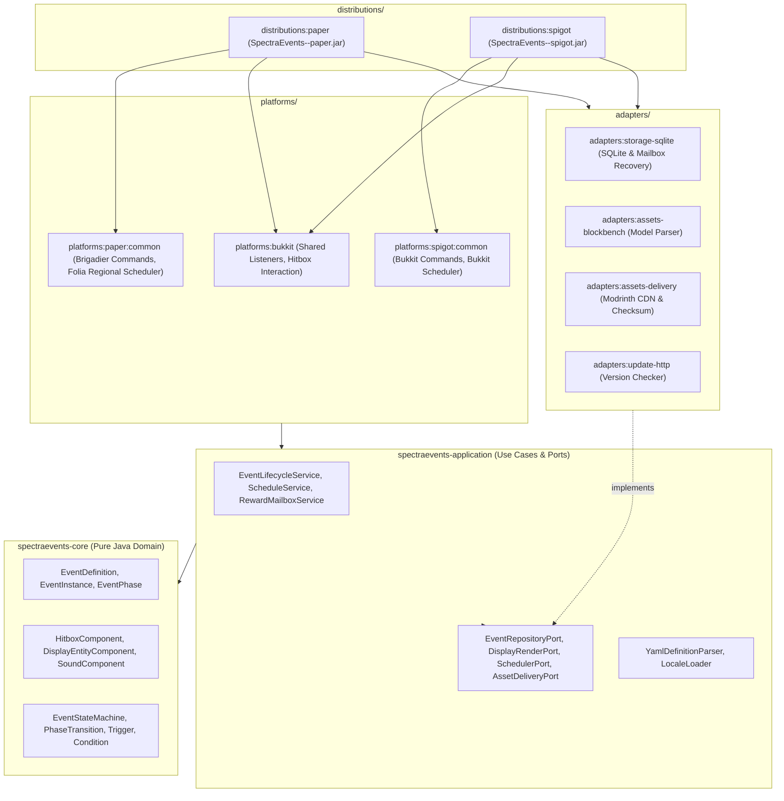

# Architecture Context — SpectraEvents

## Architectural Pattern
SpectraEvents is engineered according to **Hexagonal Architecture** (Ports and Adapters).

## Module Isolation Invariants
1. `spectraevents-core`: Pure domain logic (Java 21), zero Bukkit or Minecraft dependencies.
2. `spectraevents-application`: Use cases, schedulers, parsers, and outbound SPI ports (Java 21).
3. `adapters/`: Infrastructure implementations (SQLite, Blockbench, Modrinth CDN).
4. `platforms/`: Server platform bridges for Paper and Spigot.
5. `distributions/`: Packaged shaded release JARs with relocation and manifest configuration.
