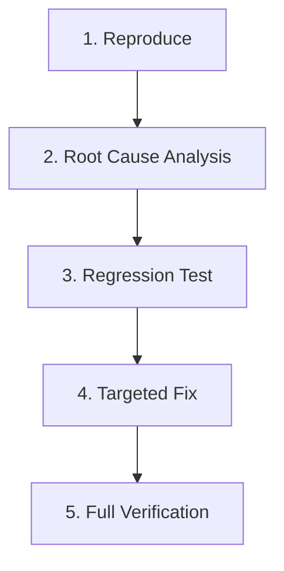

# Bug Fix Workflow

This workflow defines the mandatory process for reproducing, fixing, and verifying defects in `SpectraEvents`.



---

## Stage 1: Reproduce
- **Isolate Failure:** Identify the exact conditions triggering the defect (e.g. server crash during claim delivery, model despawn on chunk unload).
- **Log Inspection:** Capture relevant stack traces and diagnostic output.

---

## Stage 2: Root Cause Analysis
- Identify the underlying flaw (e.g., race condition, non-atomic persistence, missing PDC tag, invalid mathematical calculation).
- Check git history and blame for prior changes in that area.

---

## Stage 3: Regression Test
- Write a failing test that reproduces the bug before modifying production code.
- Ensure the test fails for the expected reason.

---

## Stage 4: Targeted Fix
- Implement the minimal, clean fix addressing the root cause.
- Avoid introducing workarounds, blanket try-catch blocks, or warning suppressions.

---

## Stage 5: Full Verification
- Confirm the regression test passes.
- Execute full quality gate:
  ```bash
  ./gradlew spotlessApply
  ./scripts/verification/validate-source-hygiene.sh
  ./scripts/verification/validate-structure.sh
  ./gradlew clean check build
  ```
- Document the fix in `CHANGELOG.md`.
