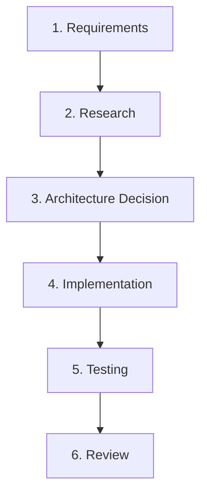

# New Feature Workflow

This workflow defines the mandatory process for designing, implementing, and delivering new capabilities in `SpectraEvents`.

---

## Stage 1: Requirements
- **Define Objective:** What gameplay or engine primitive does this feature provide?
- **Scope & Constraints:**
  - Data-driven first: Can it be declared in YAML definitions?
  - Platform independence: Domain logic in `core` and `application` must target Java 21 without Bukkit/Paper dependencies.
  - Multi-platform parity: Must operate on both Paper and Spigot distributions.
  - Performance: Must not cause tick stalls or blocking I/O on region/tick threads.

---

## Stage 2: Research
- **Inspect Core Primitives:** Check existing actions (`PlatformActions`, `CoreActions`), conditions, triggers, or phases.
- **Inspect Platform Adapters:** Determine if platform-specific presentation requires `:platforms:bukkit` or specialized Paper/Spigot dispatchers.
- **Check Prior ADRs:** Read relevant ADRs in `docs/architecture.md`.

---

## Stage 3: Architecture Decision
- **Module Placement:**
  - Pure domain rules -> `spectraevents-core`.
  - Orchestration & lifecycle -> `spectraevents-application`.
  - Common Bukkit presentation -> `:platforms:bukkit`.
  - Platform-specific hooks -> `:platforms:paper:common` or `:platforms:spigot:common`.
- **Explain Trade-offs:** Ensure architectural boundaries and single-responsibility principles are preserved.

---

## Stage 4: Implementation
- Implement classes with explicit types, immutability (`record`), and zero `@SuppressWarnings`.
- Ensure Spotless formatting: `./gradlew spotlessApply`.

---

## Stage 5: Testing
- Write comprehensive unit tests for core/application logic.
- Verify instruction coverage remains $\ge 85\%$.
- Execute: `./gradlew check`.

---

## Stage 6: Review
- Run `./scripts/verification/validate-source-hygiene.sh`.
- Run `./scripts/verification/validate-structure.sh`.
- Update `docs/wiki/` and `CHANGELOG.md` with new feature capabilities.
