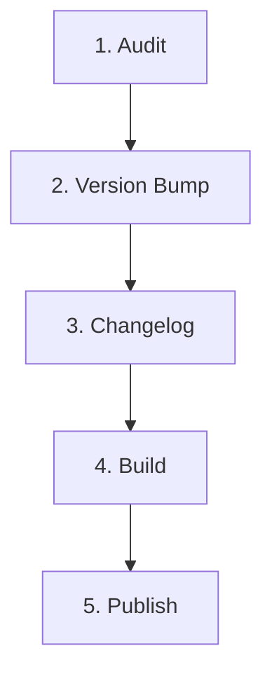

# Release Workflow

This workflow defines the mandatory release procedure for publishing official versions of `SpectraEvents`.



---

## Stage 1: Audit
- **Check Working Tree Status:**
  - `git status` must be clean. No uncommitted modifications or untracked files.
- **Check Active Branch:**
  - Releases must originate from `main`, `release/*`, or `support/*`.
- **Pre-Release Verification:**
  - Run the release script in dry-run mode:
    ```bash
    ./scripts/release/release.sh --dry-run
    ```
  - This executes hygiene checks, structure validation, strict compilation, test runs, and test artifact builds.

---

## Stage 2: Version Bump
- **SemVer Compliance:**
  - Increment version according to SemVer rules:
    * `PATCH`: Bug fixes, minor adjustments, compatibility metadata updates.
    * `MINOR`: New features, new action/trigger types, new default templates (backwards compatible).
    * `MAJOR`: Breaking changes to definition format, schema, or core architecture.
- **Update Version:**
  - Update `spectraevents.version` in `gradle.properties`.

---

## Stage 3: Changelog
- **Format:**
  - Ensure `CHANGELOG.md` contains a dedicated heading for the new release (`## <version>`).
  - Summarize changes under: Added, Changed, Deprecated, Removed, Fixed, Security.

---

## Stage 4: Build
- **Build and Quality Gate:**
  ```bash
  ./gradlew clean check build
  ```
- **Verify Artifacts:**
  - Confirm the existence of:
    - `distributions/paper/build/libs/SpectraEvents-<version>-paper.jar`
    - `distributions/spigot/build/libs/SpectraEvents-<version>-spigot.jar`

---

## Stage 5: Publish
- **Publish Release:**
  - Execute official release publication:
    ```bash
    ./scripts/release/release.sh --publish
    ```
  - Creates the signed git tag, pushes branch and tag to origin, triggering the GitHub Actions CI/CD release workflow.
